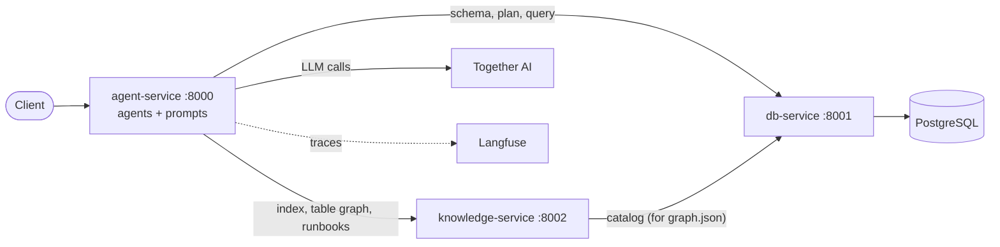
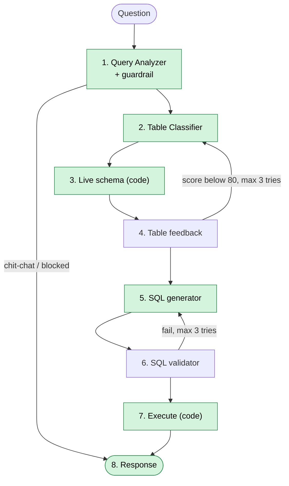

# nl2sql-agents

Ask a question about your data in plain English. A small team of LLM agents finds the right tables,
writes a SQL `SELECT`, and a guarded read-only service runs it. You get back an answer and the rows.

> [!TIP]
> **[Open the interactive architecture explorer](https://dhruvesh9.github.io/nl2sql-agents/explorer/)**:
> pick a scenario and watch the question flow through the agents and services, with the safety layers and the error contract.
> No setup is needed. It uses example data and does not call a real model or database.

Built as three small FastAPI services plus an eval project that measures every agent against ground truth.

**Stack:** Python 3.12+, FastAPI, PostgreSQL, SQLAlchemy, sqlglot, networkx, Together AI, Langfuse (optional), pytest.

```bash
curl -s -X POST localhost:8000/ask-quick -H 'Content-Type: application/json' \
  -d '{"question": "Total refund amount per customer city"}'
```

```json
{
  "answer": "Here are the results (3 rows).",
  "data": {
    "columns": ["city", "total_refund_amount"],
    "rows": [["Leeds", 130.0], ["London", 125.0], ["Glasgow", 160.0]],
    "truncated": false
  },
  "request_id": "15156728e806"
}
```

## Contents

- [Architecture](#architecture)
- [Status](#status)
- [Quickstart](#quickstart)
- [Use your own database](#use-your-own-database)
- [API](#api)
- [Design decisions](#design-decisions)
- [Configuration](#configuration)
- [Tests and evals](#tests-and-evals)
- [Project structure](#project-structure)
- [Roadmap](#roadmap)

## Architecture



| Service | Job |
|---|---|
| `agent-service` | The workflow and the prompts. Each agent is one LLM call with a small, controlled context. |
| `db-service` | The only component that connects to the database. Exposes `/catalog`, `/schema`, `/plan`, `/query`. |
| `knowledge-service` | Owns the business knowledge: `index.md`, the generated table graph, and runbooks (business rules). |

The agent never touches the database or the knowledge files. It calls the two services over HTTP,
so each part can change, deploy, and be owned separately.

### Pipeline



Green steps are implemented. Steps 4 and 6 and the two feedback loops are planned.

## Status

| Endpoint | State |
|---|---|
| `POST /ask-quick` | **Works.** Steps 1, 2, 3, 5, 7, 8 with no feedback loops. It runs SQL that no validator has checked, so use it to see the flow end to end. |
| `POST /ask` | Planned. Returns `501 NOT_IMPLEMENTED`. It adds table feedback (Loop A) and the SQL validator (Loop B). |

Working today: all three services, the Query Analyzer with a guardrail, the Table Classifier, the SQL Generator,
runbook loading, the Response Agent with a fixed error contract, request IDs, JSON logs, Langfuse traces,
timeouts and edge-error handling, and the eval harness.

## Quickstart

You need Python 3.12+, PostgreSQL 16+ (or Docker), `make`, `curl`, and a [Together AI](https://api.together.ai) API key.

**1. Create the database with the sample data** (a telecom billing schema with 25 tables).

Option A, Docker (easiest). The first start creates the tables, loads the data, and creates the read-only role by itself:

```bash
make db-up        # make db-down stops it, make db-reset starts again from zero
```

Option B, your own local PostgreSQL:

```bash
sudo -u postgres psql -c "CREATE DATABASE nl2sql OWNER admin;"   # any owner role works
PGPASSWORD=<password of the owner> make db-load
# another owner: make db-load LOCAL_DB_URL=postgresql://user@localhost:5432/nl2sql
```

Or skip both and [use your own database](#use-your-own-database).

**2. Create a virtual environment for each project, and the `.env` files**

```bash
for p in db-service agent-service knowledge-service eval; do
  python3 -m venv $p/.venv && $p/.venv/bin/pip install -r $p/requirements-dev.txt
done
for p in db-service agent-service knowledge-service; do cp $p/.env.example $p/.env; done
# then put your TOGETHER_API_KEY in agent-service/.env
```

The example `.env` files and `docker-compose.yml` hold demo values (`change-me`, `reader_pw`). Change them for anything that is not local.

Run the services, one terminal each:

```bash
make dbsvc        # db-service on http://localhost:8001
make knowledge    # knowledge-service on http://localhost:8002
make agent        # agent-service on http://localhost:8000
```

Or start everything in the background with `make up` (logs go to `.run/`, `make down` stops the services).
If PostgreSQL is down, `make up` starts it with Docker, or else tries a local cluster with `sudo`.

Check health with `curl localhost:8001/health`, `curl localhost:8002/health`, `curl localhost:8000/health`.
Then send the `curl` request from the top of this file.

## Use your own database

You have two choices. The **sample database** is the default: `make db-up` creates it from the SQL scripts in
`database/init/`, and the shipped knowledge base describes it. Or you use **your own database**.
The services talk to each other only over REST, and no table name is hard-coded in the Python code.
So you can point the system at your own PostgreSQL database and your own knowledge base.

1. **Point db-service at your database.** Set `DATABASE_URL` in `db-service/.env`. Any PostgreSQL works,
   including hosted providers such as Supabase. Use a role that has only `SELECT`
   (see `database/init/03_readonly_user.sql` for an example).
2. **Describe your tables.** Table and column descriptions come from PostgreSQL comments
   (`COMMENT ON TABLE ...`, `COMMENT ON COLUMN ...`). The agents read them live. Good comments, especially on
   code columns such as `status`, improve accuracy more than anything else.
3. **Build the table graph.** With `db-service` and `knowledge-service` running, run `make kb-generate`.
   It reads every table and foreign key from your database and writes `knowledge-service/knowledge_base/graph.json`.
   No LLM is used.
4. **Write your knowledge base.** In `knowledge-service/knowledge_base/`, replace `index.md` and `runbooks/*.md`
   with your own. A runbook is a short Markdown file with a business rule or a join that has no foreign key.
   List each one in `index.md` with keywords. No code change is needed. You can also point
   `KNOWLEDGE_BASE_DIR` in `knowledge-service/.env` to another folder. An empty `runbooks/` folder works too.
5. **Change one prompt line.** `agent-service/app/prompts/query_analyzer.md` says the data is "a telecom billing
   database". Change that domain wording so the analyzer knows what counts as an on-topic question.
6. **Eval (optional).** `eval/dataset/questions.toml` holds the questions for the sample database.
   Replace it with questions and gold SQL for your schema to measure your own accuracy.

Limits:
- **PostgreSQL only for now.** The dialect-specific code (`EXPLAIN`, read-only transactions) is isolated in
  `db-service/app/planner.py` and `db-service/app/database.py`, so another database needs changes in those two files.
- The sample runbooks, `graph.json`, and eval questions describe the sample telecom schema. They do not apply to another schema.

## API

No authentication for now, so local testing is easy (Keycloak and JWT are planned).

### agent-service

`POST /ask-quick` and `POST /ask` take the same request and return the same response shape.

```json
{"question": "Total unpaid invoice amount per customer in 2025"}
```

- `answer` is always a text.
- `data` (`columns`, `rows`, `truncated`) is present only when the query returned rows. A client can show it as a table or chart.
- `code` is present only for an error. It is a short stable value, for example `LLM_BUSY`, `TIMEOUT`, `QUERY_FAILED`,
  `DATA_CHANGE_NOT_ALLOWED`, `REQUEST_BLOCKED`, `SERVICE_UNAVAILABLE`, `INVALID_REQUEST`, `NOT_IMPLEMENTED`, `INTERNAL_ERROR`.
  The body has the same shape for every status, also for a crash or an unknown path.
- `request_id` is in every response. Send your own `X-Request-ID` header (8 to 64 characters of `A-Za-z0-9._-`) or get a generated one.

Result rows never go to the LLM, except one single value (for example a count), which lets the model write a sentence.
Turn that off with `RESPONSE_LLM_SEES_VALUES=false`. The client never receives the SQL or a stack trace.
They go to the logs and to Langfuse, with the request ID.

### db-service and knowledge-service

| Service | Endpoints |
|---|---|
| db-service | `GET /catalog`, `POST /schema`, `POST /plan`, `POST /query`, `GET /health` |
| knowledge-service | `GET /index`, `GET /graph`, `GET /runbooks/{name}`, `POST /generate`, `GET /health` |

Details and examples are in [`db-service/README.md`](db-service/README.md) and
[`knowledge-service/README.md`](knowledge-service/README.md).

## Design decisions

**Three layers keep the database read-only.**
1. The agent-side guardrail in the Query Analyzer stops requests to change data and prompt injection at step 1, with a fixed refusal text.
2. In `db-service`, a sqlglot parser accepts exactly one `SELECT` (unions and subqueries are fine) and rejects
   `INSERT`, `UPDATE`, `DELETE`, `DROP`, `SELECT INTO`, and locking clauses.
3. The service connects with a role that has only `SELECT`, runs each query in a `READ ONLY` transaction,
   and enforces a statement timeout and a row limit.

The guardrail is an LLM decision and can be wrong. Layers 2 and 3 are not LLM decisions. `/plan` uses `EXPLAIN`,
never `EXPLAIN ANALYZE`, so a plan check never runs the query.

**No RAG, no embeddings.** The knowledge base is small, so the agent sends the needed text to the LLM.
This removes retrieval errors. Runbook text is loaded only when it is relevant, to keep the context small.

**Schema details come live from the database, never from Markdown.** The knowledge base holds only what the
database cannot say: the table graph (comments and foreign keys, generated), and business rules.

**The table graph is generated.** `POST /generate` builds `graph.json` from the foreign keys, with no LLM.
The classifier sees one line per table and one line per foreign key.

**Errors are mapped in one place.** An agent raises an error when it fails and writes no user text.
The pipeline catches every error and gives it to the Response Agent, which maps it to a stable `code` and a fixed message.

**Each agent has its own LLM settings.** Model, temperature, `top_p`, `top_k`, and reasoning on or off are set per
agent in `.env`. See [Configuration](#configuration).

**Observable by default.** Every request has an ID that flows through all three services and into every JSON log line.
Optional Langfuse tracing records one trace per request, with one observation per pipeline step.

**Simple code.** Plain functions, sync code, one file per agent, one Markdown prompt per agent, all settings in
`config.py`. A new reader should understand each file without help.

**Any PostgreSQL works.** The only database setting is `DATABASE_URL`. A hosted provider such as Supabase should work by changing
that one value. I have not tested a hosted provider yet.

## Measured results

Every agent must reach 90% on its own ground truth before the next agent is built.
The Table Classifier is scored on the data questions in [`eval/dataset/questions.toml`](eval/dataset/questions.toml).
Each expected table list includes the tables on the join path, and the tests check it against the real schema.
PASS is an exact match. WARN means all expected tables plus extra ones, and counts as a success.
FAIL means a missing table, because a missing table costs a retry later.

| What changed | Table accuracy |
|---|---|
| Table descriptions that name the related tables (hand-written hints) | 96.7% |
| Plain descriptions only, no hints | 80.0% |
| Plain descriptions + a table-relationship list (one `A -> B` line per foreign key) | 96.7% |
| Same, with reasoning turned off for speed | 93.3% |

- **A table-link list recovers the accuracy** without hand-written hints. It is now generated from the foreign keys.
- **Reasoning cost most of the time.** With reasoning off, one call dropped from 4.5 s to 1.3 s, and the whole eval run from
  about 8 minutes to 1.5 minutes. One question lost a bridge table, so reasoning is a per-agent setting: off for the analyzer, on for the classifier.
- With about 30 questions, one question is 3.3 points, so small differences between runs are noise.

## Configuration

Each service reads its settings from its own `.env` file. See the `.env.example` files.
LLM options can be set per agent, one line each. An option you do not set uses the default:

```bash
LLM_MODEL=Qwen/Qwen3.8-Flash
LLM_REASONING_ENABLED=false                 # default for all agents
TABLE_CLASSIFIER__REASONING_ENABLED=true    # this agent thinks before it answers
# TABLE_CLASSIFIER__TEMPERATURE=0   TABLE_CLASSIFIER__TOP_P=0.9   TABLE_CLASSIFIER__TOP_K=40
# QUERY_ANALYZER__MODEL=<a smaller, faster model>
```

Time limits (`LLM_TIMEOUT_SECONDS`, `REQUEST_TIMEOUT_SECONDS`, `STATEMENT_TIMEOUT_MS`, ...) are in the same files.
For tracing, set `LANGFUSE_ENABLED=true` and the Langfuse keys in `agent-service/.env`. It is off by default,
and a tracing failure never breaks a request. Set `LOG_FORMAT=text` for readable logs in a terminal.

## Tests and evals

```bash
make test         # tests of all four projects
make lint         # ruff
make eval         # dev eval: classifier, SQL generator, whole system (needs make up, and real LLM calls)
```

The tests need no API key and no running service. The agent tests use a fake LLM and a fake HTTP layer.
About 28 `db-service` tests need the sample database from the quickstart, and are skipped without it.
The eval makes real LLM calls. It writes a log for each question and a CSV to `eval/results/`.
See [`eval/README.md`](eval/README.md).

## Project structure

```
database/init/         sample database: schema, seed data, read-only role (run by docker-compose.yml)
docker-compose.yml     local PostgreSQL that loads database/init/ on its first start
db-service/            SQL guard, schema reader, planner, executor
knowledge-service/     knowledge_base/: index, generated table graph, runbooks
agent-service/         agents, prompts, LLM client, knowledge client, tracing
eval/                  ground truth and runners that score each agent
explorer/              interactive architecture page (GitHub Pages)
scripts/               start-all.sh and stop-all.sh (used by make up / make down)
Makefile               db-load, up, down, dbsvc, knowledge, agent, eval, test, lint
```

## Roadmap

| Step | Status |
|---|---|
| db-service: catalog, schema with foreign key expansion, plan, query, SQL guard | Done |
| knowledge-service: index, runbooks, generated table graph | Done |
| Query Analyzer with guardrail, Table Classifier, SQL Generator | Done |
| Response Agent, error contract, request IDs, structured logs, Langfuse traces | Done |
| `POST /ask-quick` end to end | Done |
| Eval harness with ground truth and per-question logs | Done |
| Table feedback agent (Loop A) | Planned |
| SQL validator with a plan check and an LLM judge (Loop B) | Planned |
| `POST /ask` end to end | Planned |
| Shortest-path join discovery in code, so the LLM only picks the main tables | Planned |
| Authentication (Keycloak, JWT) | Planned |
| Hosted PostgreSQL test (Supabase), CI | Planned |

## License

[MIT](LICENSE)
