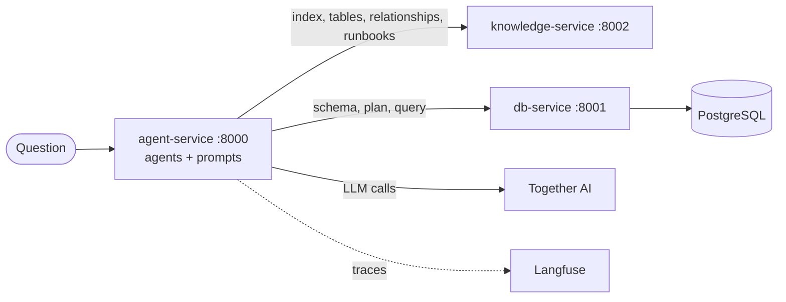
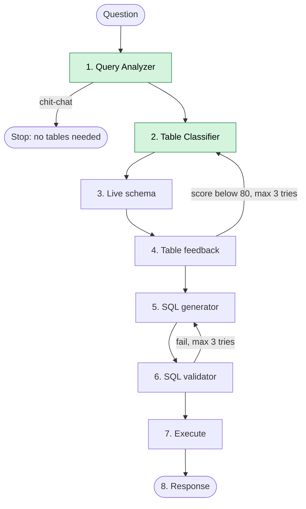

# nl2sql-agents

Ask a question in plain English. LLM agents find the right tables in your database, and a guarded
read-only service runs the SQL. Built as three small FastAPI services, with an eval project
that measures the accuracy of every agent before the next one is built.

**Stack:** Python 3.13, FastAPI, PostgreSQL, SQLAlchemy, sqlglot, Together AI, Langfuse, pytest.

> **Status:** work in progress. The database layer, the knowledge base, the first two agents, and the
> eval harness work today. The SQL generator and the feedback loops are next. See the [roadmap](#roadmap).

## What works today

Send a question to `POST /ask-quick`. It runs the flow end to end with no feedback loops:
query analyzer, table classifier, live schema, SQL generator, and query execution.

```bash
curl -s -X POST localhost:8000/ask-quick -H 'Content-Type: application/json' \
  -d '{"question": "Total refund amount per customer city"}'
```

```json
{
  "status": "success",
  "sql": "SELECT a.city, SUM(r.amount) AS total_refund_amount FROM refunds r JOIN payments p ON r.payment_id = p.id JOIN invoices i ON p.invoice_id = i.id JOIN accounts acc ON i.account_id = acc.id JOIN customers c ON acc.customer_id = c.id JOIN addresses a ON c.billing_address_id = a.id GROUP BY a.city",
  "columns": ["city", "total_refund_amount"],
  "rows": [["Leeds", 130.0], ["London", 125.0], ["Glasgow", 160.0]],
  "failure_reason": null
}
```

A greeting such as "hello" stops after agent 1. It needs no tables, so it costs one LLM call.
The step details (time and summary of each step) go to the agent-service log and to Langfuse.
`POST /ask` is the full flow with the feedback loops. It is not implemented yet.

## Architecture



| Service | Job |
|---|---|
| `agent-service` | The workflow and the prompts. Each agent is one LLM call with a small, controlled context. |
| `db-service` | The only component that connects to the database. It exposes `/schema`, `/plan`, and `/query`. |
| `knowledge-service` | Owns the business knowledge: table descriptions, table relationships, and runbooks (business rules). |

The agent never touches the database or the knowledge files. It calls the two services over HTTP.
So each part can change, deploy, and be owned separately.

### The full pipeline (target design)



Green steps work today. The `db-service` endpoints behind steps 3, 6, and 7 (`/schema`, `/plan`, `/query`) are
also done and tested. The agent-side wiring of those steps comes with the pipeline.

## Design decisions

**The database is read-only in three layers.** Every query must pass a sqlglot parser that accepts only
`SELECT` (with unions and subqueries) and rejects `INSERT`, `UPDATE`, `DELETE`, `DROP`, `SELECT INTO`,
and locking clauses. Then the service connects with a database role that has only `SELECT`, runs the query in
a `READ ONLY` transaction, and enforces a statement timeout and a row limit. `/plan` uses `EXPLAIN`, never
`EXPLAIN ANALYZE`, so a plan check never runs the query.

**No RAG, no embeddings.** The knowledge base is small, so the agent sends the whole text to the LLM.
This removes retrieval errors. Runbook text is loaded only when it is relevant, to keep the context small.

**Schema details come live from the database, never from Markdown.** The knowledge base holds only what
the database cannot say: short table descriptions, the table links, and business rules.

**The knowledge base is its own service.** The agent caches each document for a short time (TTL). If the
service fails during a refresh, the agent keeps the old copy, so a short outage does not stop it.
A 404 is never hidden by the cache.

**Each agent has its own LLM settings.** Model, temperature, `top_p`, `top_k`, and reasoning on or off are set per agent
in `.env`, for example `TABLE_CLASSIFIER__REASONING_ENABLED=true`. See [Configuration](#configuration).

**Any PostgreSQL works.** The only database setting is `DATABASE_URL`, and dialect code is in one place.
It is built to move to a hosted provider such as Supabase by changing that one value. I have not tested a hosted provider yet.

## Measured results

Every agent must reach 90% on its own ground truth before the next agent is built.
The Table Classifier is scored on 30 questions in [`eval/ground_truth/table_classifier.csv`](eval/ground_truth/table_classifier.csv).
Each expected table list includes the tables on the join path, and the tests check it against the real schema.
Scoring: PASS is an exact match. WARN means all expected tables plus extra ones, and counts as a success.
FAIL means a missing table, because a missing table costs a retry loop later.

| What changed | Table accuracy |
|---|---|
| Table descriptions that name the related tables (hand-written hints) | 96.7% |
| Plain descriptions only, no hints | 80.0% |
| Plain descriptions + a `table_relationship.md` file (one `A -> B` line per foreign key) | 96.7% |
| Same, with reasoning turned off for speed | 93.3% |

Findings:
- **A table-link file recovers the accuracy** without hand-written hints in the descriptions. It can be generated from the foreign keys.
- **Reasoning cost most of the time.** In one measured call the model spent about 4 seconds on hidden thinking tokens for a 30-token
  answer. With reasoning off, the call dropped from 4.5s to 1.3s, and the whole eval run from about 8 minutes to 1.5 minutes. One
  question lost a bridge table, so reasoning is now a per-agent setting: off for the analyzer, on for the classifier.
- With 30 questions, one question is 3.3 points, so small differences between runs are noise.

## Quickstart

You need Python 3.12+, PostgreSQL 16, `make`, `psql`, and a [Together AI](https://api.together.ai) API key.

```bash
# 1. Create the database and load the sample data (a telecom billing schema with 25 tables)
sudo -u postgres psql -c "CREATE DATABASE nl2sql OWNER admin;"
PGPASSWORD=<password of the owner> make db-load

# 2. Create a virtual environment for each project
for p in db-service agent-service knowledge-service eval; do
  python3 -m venv $p/.venv && $p/.venv/bin/pip install -r $p/requirements-dev.txt
done

# 3. Create the .env files, then put your TOGETHER_API_KEY in agent-service/.env
for p in db-service agent-service knowledge-service; do cp $p/.env.example $p/.env; done
```

The default database owner in the Makefile is `admin`. For another owner, run
`make db-load LOCAL_DB_URL=postgresql://user@localhost:5432/nl2sql`.
The example `.env` files use demo values (`change-me`, `reader_pw`). Change them for anything that is not local.

Run the services, one terminal each:

```bash
make dbsvc        # db-service on http://localhost:8001
make knowledge    # knowledge-service on http://localhost:8002
make agent        # agent-service on http://localhost:8000
```

Then use the `curl` command from [What works today](#what-works-today). Health checks:
`curl localhost:8001/health`, `curl localhost:8002/health`, `curl localhost:8000/health`.

## Configuration

Each service reads its settings from its own `.env` file. See the `.env.example` files.
LLM options can be set for each agent, with one line each. An option that you do not set uses the default:

```bash
LLM_MODEL=Qwen/Qwen3.8-Flash
LLM_REASONING_ENABLED=false                 # default for all agents
TABLE_CLASSIFIER__REASONING_ENABLED=true    # this agent thinks before it answers
# TABLE_CLASSIFIER__TEMPERATURE=0   TABLE_CLASSIFIER__TOP_P=0.9   TABLE_CLASSIFIER__TOP_K=40
# QUERY_ANALYZER__MODEL=<a smaller, faster model>
```

Optional tracing: set `LANGFUSE_ENABLED=true` and the Langfuse keys in `agent-service/.env`.
Every LLM call then appears as a span with its model, options, and token counts. Tracing is off by default,
and a tracing failure never breaks a request.

## Tests and evals

```bash
make test         # 189 tests across the four projects (db-service needs the database from step 1)
make lint         # ruff
make eval-tables  # score the Table Classifier (needs make knowledge and make agent)
```

The tests need no API key and no running service, except the database for `db-service`.
The agent tests use a fake LLM and a fake HTTP layer. The eval makes real LLM calls.
The eval writes a log for each question (what each step returned, what was expected, and why it passed or failed)
and a CSV to `eval/results/`. See [`eval/README.md`](eval/README.md).

## Project structure

```
database/init/         sample database: schema, seed data, read-only role
db-service/            SQL guard, schema reader, planner, executor     (see its README for the API)
knowledge-service/     knowledge_base/: index, tables, relationships, runbooks    (see its README)
agent-service/         agents, prompts, LLM client, knowledge client, tracing
eval/                  ground truth and runners that score each agent
Makefile               db-load, dbsvc, knowledge, agent, eval-tables, test, lint
```

## Roadmap

| Step | Status |
|---|---|
| db-service: `/schema` with foreign key expansion, `/plan`, `/query`, SQL guard | Done |
| knowledge-service: index, tables, relationships, runbooks | Done |
| Agent 1: Query Analyzer | Done |
| Agent 2: Table Classifier, with an eval at 90% or more | Done |
| Eval harness with ground truth and per-question logs | Done |
| Runbook text for the Table Classifier (the usage-to-subscriptions link has no foreign key) | Next |
| Table graph (`graph.json`, networkx) generated from the live database; replaces `tables.md` and `table_relationship.md` | Done |
| Shortest-path join discovery in code, so the LLM only picks the main tables | Planned |
| Agent 3: Table feedback loop (steps 3 and 4) | Planned |
| Agent 4: SQL Generator, and Agent 5: SQL Validator with a plan check and a judge | Planned |
| `POST /ask` end to end, with the execution and response steps | Planned |
| Knowledge version check for an instant cache refresh | Planned |
| Hosted PostgreSQL test (Supabase), CI | Planned |

## License

[MIT](LICENSE)
